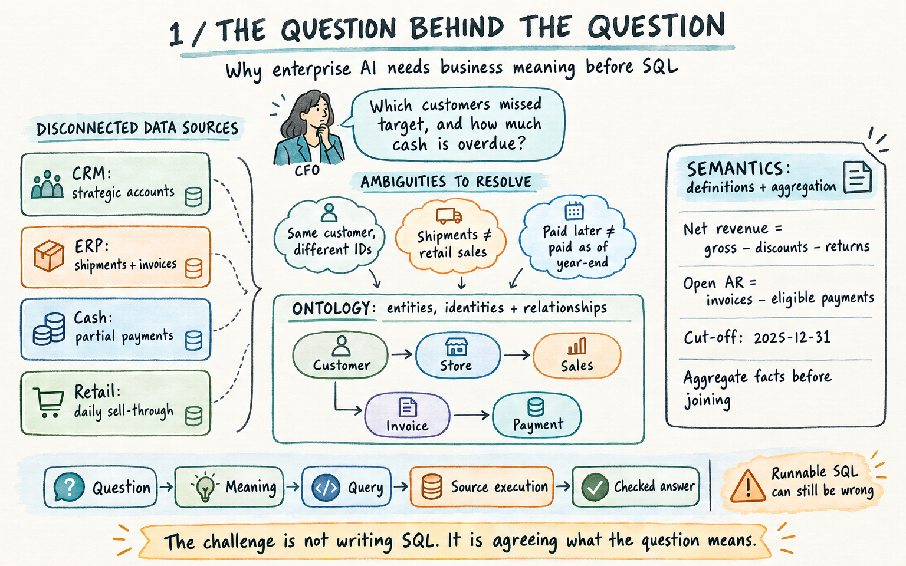

# Ontology Grounded NL2SQL

How do we turn a business question into a trustworthy query, rather than merely executable SQL?

This illustrated architecture brief explores how explicit entity mappings, governed measures, grain-aware planning, and independent validation help natural-language-to-SQL systems preserve business intent.

## Start reading

**[Read the illustrated architecture brief](./ontology-nl2sql-architecture-brief.md)**

The post follows a fictional consumer-goods question: **"Which customers missed target, and how much cash is overdue?"** It shows why answering correctly requires resolving customer identities, selecting authoritative facts, and applying consistent reporting cut-offs.

## What you will learn

- Define a semantic contract covering identity, physical bindings, relationships, measures, grain, and time.
- Ground a logical plan instead of relying on schema retrieval alone.
- Distinguish context supplied to a model from independently enforced controls.
- Compare semantic placement, query execution, and ownership boundaries across Microsoft Fabric, Databricks Genie, and NVIDIA Auto-Ontology.
- Validate results against adversarial cases such as join fan-out, duplicate mappings, and future payments.
- Plan production controls for revisions, authorization-aware caching, consistency, query budgets, and observability.

## Who this is for

Data architects, analytics engineers, and AI application developers designing or evaluating enterprise NL2SQL systems.

## Visual guide

| Illustration | Focus |
|---|---|
| [The question behind the question](./image-1.png) | Business meaning before SQL |
| [Microsoft Fabric](./image-2.png) | Ontology context, semantic models, and eligible execution sources |
| [Databricks Genie](./image-3.png) | Shared catalog definitions versus agent-local guidance |
| [NVIDIA Auto-Ontology](./image-4.png) | A customizable semantic catalog and query pipeline |

## Scope

This folder contains the article and its four illustrations, not a runnable application. The article links to product documentation and distinguishes architectural recommendations from platform capabilities. No comparative accuracy benchmark was performed; preview features and availability should be verified before implementation.
