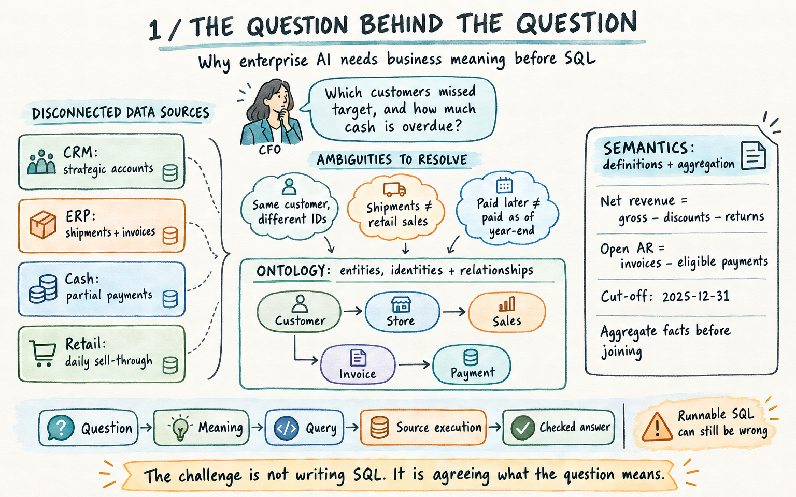
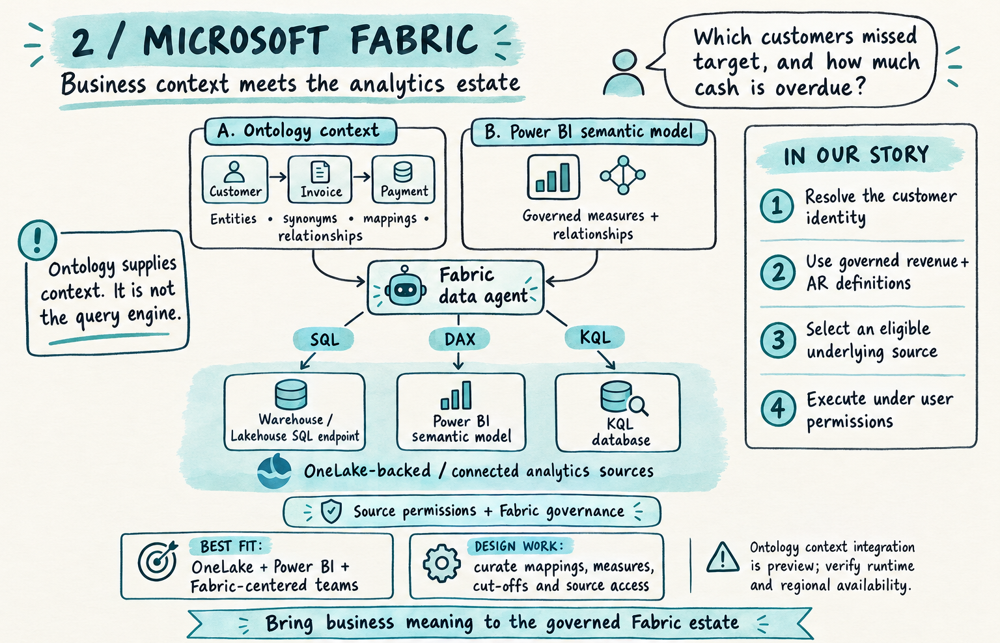
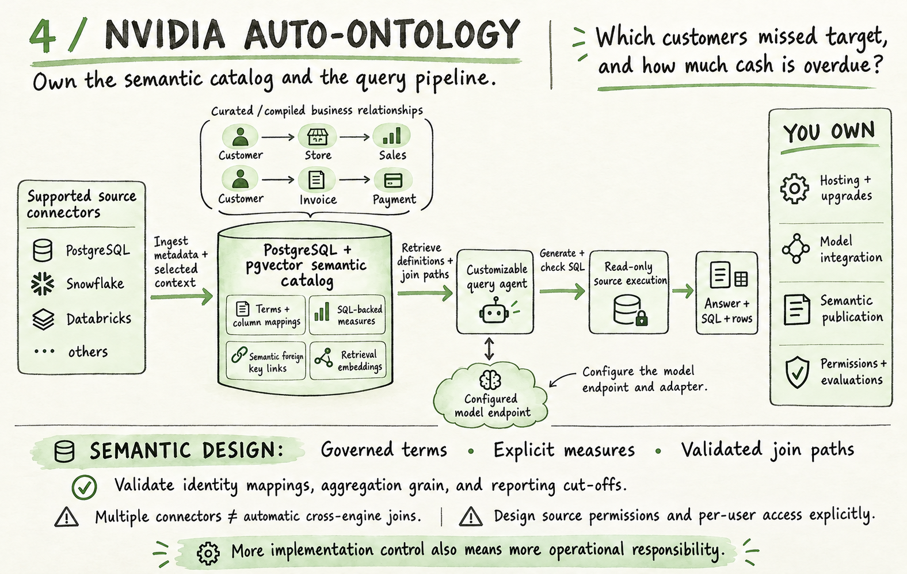

# Enterprise Ontologies - Connecting Agent Reasoning to Governed Data

## Why Microsoft Fabric ontologies and NVIDIA Auto Ontology deserve attention

I recently gave my team a demo on ontologies and their role in agentic applications. It sparked quite a few questions, which motivated me to write this post. I wanted to explain why ontologies matter, what they add beyond agent instructions, and how they connect business meaning to the data and tools agents use.
Enterprise agents can discover data, generate queries, call APIs, and coordinate tasks. But connecting those capabilities leaves a critical question unanswered - **does the agent output matches what the business expects?** For example, "Which customers missed target?" A sales agent can return revenue, a finance agent can return receivables. 

Ontologies address this gap by making business entities, relationships, and their data bindings explicit. Microsoft and NVIDIA offer different approaches to making that meaning available to agents. Their significance is not another way to chat with data. It is an architectural response to applications that must coordinate decisions across systems.

*Figure 1. Tool access connects systems. Shared business meaning makes their outputs usable together.*

## 1. Why agentic applications raise the stakes

A single assistant can hide inconsistent definitions inside one conversation. A multi agent orchestration passes those inconsistencies to downstream tasks. Each component can complete its assigned task correctly while using a different entity namespace, time horizon, unit, or definition of a result (classic case of a correct business question ending up with an incorrect response or a technical construct). 

Also worth calling here that a successful tool calls establish that an operation ran, not that its output is semantically compatible with the next operation or in this case - the actual business question!

## 2. Why shared domain contracts are stronger than duplicated instructions
An agent's ability to reason does not give it an authoritative understanding of an organization's data. It still needs to establish what an entity represents, which relationships matter, and where the relevant facts live. **Ontologies make that business knowledge explicit and reusable.** Instead of asking each agent to reconstruct meaning from table names, documents, and conversation, the application can expose a maintained model of entities, identities, relationships, and data bindings.

This matters when an agent chooses a path through connected information. Two entities may be linked in several ways, but a connection is not necessarily the relationship the task requires. An ontology names the relationship's role and identifies the objects it connects, giving the agent a basis for selecting a relevant path rather than merely a reachable one. Physical bindings then connect that path to the data or tools that can answer the request and allowing the agent to reason with confidence and avoid hallucinations or undeterministic responses.

**Ontologies can reduce LLM hallucinations** by supplying explicit definitions, declared rules, and structured context instead of leaving domain meaning to unsupported statistical inference. The model still generates tokens probabilistically, but its choices can be grounded in known entities and relationships and checked against the available definitions. When bindings (relationships), approved calculations (metrics such as calculated KPIs which are not traditionally maintained as a strict schema), this supports **more deterministic execution**: the application resolves meaning through identifiable artifacts rather than repeatedly inventing it or hallucinating. An ontology alone neither makes generation deterministic nor guarantees a correct answer but the gain depends on the model actually using accurate context and the runtime checking its output.

It is also worth clarifying which maybe often misunderstood is that **a larger system instruction adds text, not necessarily stronger grounding for use cases such as NL2SQL.** These contain useful domain knowledge, but the model must still select the relevant definitions, reconcile conflicting rules, and translate prose into data bindings on each request. More context does not guarantee that every required dependency is applied, and consuming the same large instruction on every call increases token and time cost. The distinction is not short prompts versus long prompts rather it is **repeated interpretation versus explicit, maintained dependencies**.

## 3. Microsoft Fabric Ontologies - connecting business meaning to the analytics estate

Microsoft Fabric supports [ontology](https://learn.microsoft.com/en-us/fabric/iq/ontology/overview) context for data agents. Entity definitions, relationships, mappings, and bindings help the agent interpret a question and select an underlying source. SQL, DAX, or KQL executes on that source under the user's permissions.

*Figure 2. Business context informs the query; the underlying analytics engine executes it.*

The architectural value is the separation of responsibilities. The ontology identifies accounts, customers, invoices, and their business relationships; the semantic model or source logic implements approved revenue and historical balance calculations. The data agent interprets the request and generates a source-native query, while source controls enforce the applicable data permissions. For organizations already investing in Fabric and Power BI, this offers a way to reuse business meaning alongside existing analytical definitions rather than recreate it independently in each agent's instructions.

The same Fabric ontology capabilities are also available to Copilot Studio through Fabric IQ MCP. This matters because ontology grounded experience becomes available through a tool interface in an agent building environment. The opportunity is continuity between analytical meaning and the agents consuming it hence increasing grounded responses and reducing occurrences of hallucinations.

## 4. NVIDIA Auto Ontology - open sourced and making semantic context reusable across agent frameworks

[NVIDIA Auto Ontology](https://github.com/NVIDIA/auto-ontology) takes an open source approach to generating ontology drafts from enterprise metadata, incorporating existing semantic models, validating definitions, and exposing context through MCP, CLI, and API.

*Figure 3. NVIDIA Auto-Ontology connects business definitions and source mappings to query execution. The illustrated architecture also highlights the responsibility to maintain semantics, permissions, and validation.*

The value is not merely automated documentation. It is a reusable mapping from business concepts to data and relationships, accessible beyond one application's prompt. Consider several applications asking about customer exposure: a finance assistant, an HR workflow, and a sales agent. Each needs customer or user identity, authoritative measures for KPIs, and relationship paths. A shared semantic layer (Postgres vector store) offers a place to maintain those definitions instead of implementing three independent interpretations.

Metadata driven generation can accelerate the initial modeling work, but it cannot decide every business policy: whether revenue follows shipments or invoices still requires accountable domain ownership. 

## 5. Where should an enterprise invest?

Choose based on where business meaning will be maintained, which applications must consume it, and who will operate the integration not on a claim that one ontology produces smarter agents.

| Enterprise situation | Investment to favor | Why it fits—and what to verify |
|---|---|---|
| Fabric and Power BI already host the authoritative analytical estate and Fabric data agents are the main consumers. | **Fabric ontologies** | Entity bindings and relationships can inform source selection within the existing estate. Preserve governed calculations in their owning models or sources. |
| The priority is exposing Fabric business context to Copilot Studio agents. | **Fabric ontologies with Fabric IQ MCP** | Integration for consuming a selected ontology through Copilot Studio tools using MCP available now. |
| Multiple agent frameworks need shared semantics outside a primarily Fabric centered architecture. | **NVIDIA Auto-Ontology** | This approach exposes semantic context through MCP, CLI, and API. |
| The organization prefers to keep ontology integration within its managed Microsoft platform estate. | **Fabric ontologies** | This aligns platform ownership with existing Fabric operations. |
| The application team needs control over the semantic layer's deployment and integration code, and can operate it. | **NVIDIA Auto-Ontology** | This approach supports an independently integrated layer. You should plan for hosting, upgrades, connector maintenance, credentials, access controls, and evaluation. |

## 6. The payoff

A Fabric data agent can generate valid SQL, DAX, or KQL without establishing that the selected data represents the user's intended business concept. Ontology context narrows that gap through explicit entity definitions, relationship roles, and physical bindings. **Why does that matter?** Source selection and query generation can use published business definitions rather than rely solely on schema names and separately maintained instructions.

The value extends beyond one answer. Shared definitions give connected agents stable referents for interpreting and exchanging results, reducing duplicated interpretation across disciplines. Inspecting the selected source, available ontology context, and generated query helps trace a disputed result to its bindings or calculation. Definition revisions, temporal scope, units, and result granularity must still be carried and checked by the consuming application; shared context alone does not guarantee compatible outputs.

The execution boundary remains unchanged: source engines run queries, governed measures implement calculations, and authorization controls enforce access. An ontology does not replace those mechanisms. It makes their business dependencies explicit and reusable. **The strategic gain is not more fluent generation - it is a clearer, testable contract between business intent, data interpretation, and agent decisions.**

**Building the most capable agentic system is not the goal - producing dependable business outcomes is.** Better reasoning, richer tools, and more sophisticated orchestration expand what agents can do, but do not establish what those actions mean within the business. Properly modeled, maintained, and integrated ontologies supply that missing foundation. Together with governed calculations and executable controls, they complete the architecture: agentic capability grounded in business meaning, not capability for its own sake.
